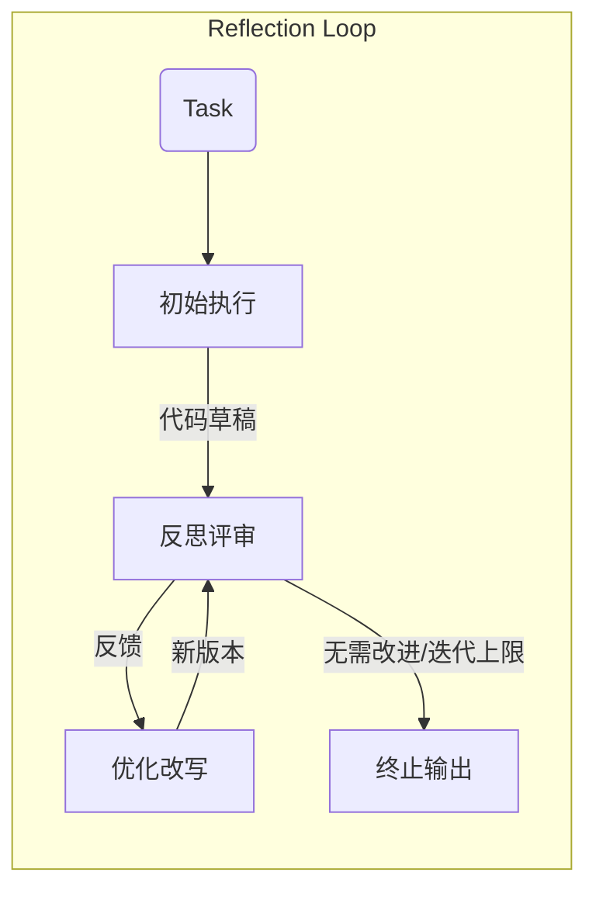

# Reflection：让智能体“做完再回头挑刺”

这篇小结梳理第四章中的 Reflection 范式——给智能体装上一套“事后自我批改”流程，让它在完成任务后还能发现问题、继续打磨方案。

## 1. 核心思想

- 反思是一个 post-hoc 循环：**执行 → 反思 → 优化**，直到没有新反馈或达到迭代上限。
- 反思角色关注的维度：事实错误、逻辑漏洞、效率瓶颈、遗漏约束，输出结构化反馈。
- 优化角色据此改写初稿，形成“修订版”。多轮迭代构成一段可复用的“短期记忆”。

## 2. 记忆模块

文章用一个极简 `Memory` 类保存轨迹：

- `add_record(type, content)`：按顺序记录执行代码或反思反馈。
- `get_trajectory()`：把完整轨迹串成文本，供后续提示词引用。
- `get_last_execution()`：拿到最近的代码版本，便于下一轮评审。

有了它，反思模型无需每次重看全量上下文，也能知道“上一轮写了什么、被批了什么”。

## 3. 提示词与流程

- **初始执行 Prompt**：直接要求产出代码（含函数签名、Docstring、PEP8）。
- **反思 Prompt**：让模型扮演苛刻的代码评审，聚焦算法效率，提出具体改进；若已最优才回复“无需改进”。
- **优化 Prompt**：给出原任务、上一版代码和反馈，要求据此生成新代码。

封装成 `ReflectionAgent` 后的主循环：

```python
# 伪代码
initial_code = llm(INITIAL_PROMPT)
memory.add_record("execution", initial_code)

for _ in range(max_iterations):
    feedback = llm(REFLECT_PROMPT(code=memory.get_last_execution()))
    memory.add_record("reflection", feedback)
    if "无需改进" in feedback:
        break
    new_code = llm(REFINE_PROMPT(last=memory.get_last_execution(), feedback=feedback))
    memory.add_record("execution", new_code)
```

终止条件：收到“无需改进”或迭代次数用完。

核心流程一图看懂：



更精简的伪代码版本，突出状态与终止：

```python
def reflection_agent(task, max_iter=3):
    code = llm(exec_prompt(task))
    memory.add_record("execution", code)
    for _ in range(max_iter):
        feedback = llm(reflect_prompt(task, code))
        memory.add_record("reflection", feedback)
        if "无需改进" in feedback:
            return code
        code = llm(refine_prompt(task, code, feedback))
        memory.add_record("execution", code)
    return code
```

## 4. 运行案例（素数函数）

任务：写出 1 到 n 的素数。流程中的关键点：

1. 初稿多为试除法，复杂度 `O(n * sqrt(n))`。
2. 反思指出效率瓶颈，建议埃拉托斯特尼筛法 `O(n log log n)`。
3. 优化后代码采用筛法；再反思时给出分段筛等进一步思路，但认为常规场景“无需改进”，流程收敛。

## 5. 价值与代价

- 价值：形成内部纠错闭环，能从“能跑”迭代到“跑得更优”；提升答案质量、鲁棒性，可扩展到多模态输出的反思。
- 代价：多轮模型调用带来成本和延迟；提示工程更复杂，需要为执行/反思/优化分别设计高质量提示词。

## 6. 适用场景

优先使用：需要高可靠性、高性能结果的任务（关键业务代码、技术报告、复杂推理、决策支持）。  
谨慎使用：对实时性敏感或“差不多即可”的场景，可考虑更轻量的 ReAct 或 Plan-and-Solve。
