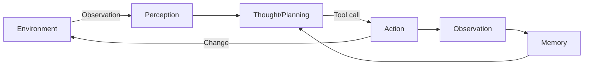
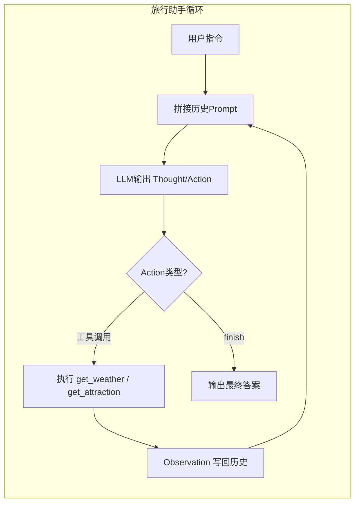
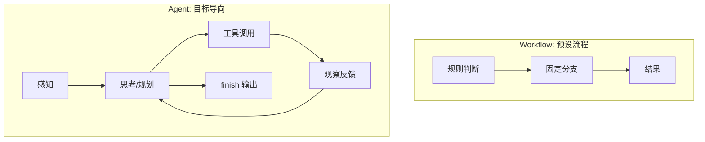

# 初识智能体

这一章想解决两个核心问题：什么是智能体，它是怎么跑起来的。下面用尽量口语化的方式把关键点串起来，外加一张简单的流程图，帮助快速建立直觉。

## 1. 智能体到底是啥？

- 定义：能**感知环境**（传感器/接口拿数据）、能**行动**（执行器/工具改环境），并且能**自主决定**怎么做事的实体。
- 四个要素：环境（外部世界）、传感器（拿信息）、执行器（改世界）、自主决策（不是死板脚本）。
- 一句话：有感知、有行动、有目标、有自主性的系统。

## 2. 传统智能体的进化路线

按复杂度从低到高，可以想成一步步给“傻程序”加能力：

1. **简单反射型**：条件-动作规则，看到温度高就开空调，没记忆也不会想未来。
2. **基于模型的反射型**：有个世界模型当“短期记忆”，比如车在隧道里也记得前方有车。
3. **基于目标的**：先定目标，再规划怎么达成（如导航找路线）。
4. **基于效用的**：不止要达成目标，还要“更满意”（省时、省钱、体验好），本质是做权衡。
5. **学习型**：靠反馈自己变聪明，强化学习是代表，奖励/惩罚驱动策略改进。

现实对应小例子：

- 简单反射：恒温器、避障小车。
- 基于模型：隧道里仍“记得”前车的自动驾驶。
- 基于目标：导航 A\* 找最短路。
- 基于效用：外卖派单平衡时长、费用、好评。
- 学习型：自我对弈的围棋 AI，游戏通关的强化学习智能体。

## 3. LLM 驱动的新范式

- 关键差异：传统智能体靠人工规则/模型，边界清晰但笨重；LLM 智能体靠大规模预训练+提示，天然会语言理解、规划、工具调用，泛化更强。
- 旅行助手例子：用自然语言拆目标→缺信息时主动查天气/价格等→根据反馈动态调整行程，步骤不是提前写死的 if-else。

简版对照表：

| 维度     | 传统智能体          | LLM 智能体             |
| -------- | ------------------- | ---------------------- |
| 核心引擎 | 规则/规划器         | 预训练大模型           |
| 知识来源 | 人工编码的知识库    | 海量语料+隐式世界模型  |
| 交互方式 | 结构化输入/固定接口 | 自然语言+工具调用      |
| 适用场景 | 边界清晰、规则稳定  | 开放指令、多变信息缺口 |

## 4. 三个常用分类视角

1. **内部决策架构**：反射 → 模型 → 目标 → 效用 → 学习（对应上面的进化阶梯）。
2. **时间维度**：反应式（快但短视）、规划式（深思熟虑但慢）、混合式（两套系统协同，LLM 智能体常走“思考-行动-观察”小循环）。
3. **知识表示**：符号主义（规则/知识库，可解释但脆弱）、亚符号主义（神经网络，强感知但像黑箱）、神经符号混合（LLM 生成结构化中间步骤，兼顾直觉与推理）。

## 5. 任务环境与 Agent 循环

- 用 PEAS 描述环境：性能指标 (P)、环境 (E)、执行器 (A)、传感器 (S)。旅行助手例子：指标=行程质量/预算/满意度，环境=航班酒店/天气/用户反馈，执行器=查询接口/下单，传感器=用户输入/API 返回。
- 常见环境特性：部分可观测（信息不全）、随机性（价格随时变）、多智能体（别人也在下单）、序贯且动态（现在的动作影响后面）。
- 运行机制：感知 → 思考（规划+选工具） → 行动 → 观察反馈 → 更新记忆，再循环。

旅行助手 PEAS 快表：

| 组件        | 内容                                   |
| ----------- | -------------------------------------- |
| Performance | 成本、时效、行程满意度                 |
| Environment | 航班/酒店实时数据、天气、用户偏好/反馈 |
| Actuators   | 查询/预订接口、行程生成、消息回复      |
| Sensors     | 用户输入、API 返回的数据、上下文记忆   |

环境特性速记：

- 可观测性：部分可观测（一次拿不到全部航班）。
- 确定性：随机性（价格/库存波动）。
- 智能体数量：多智能体（其他用户/脚本同时下单）。
- 序贯性与动态性：当前决策影响后续，且环境持续变化。



## 6. 亲手搭一个小例子（旅行助手）

- **工具层**：`get_weather` 查天气；`get_attraction` 基于城市+天气给景点建议。
- **LLM 客户端**：兼容 OpenAI 风格接口，接受系统提示+历史对话，输出下一步。
- **主循环**：把用户需求和历史观察拼进 Prompt → 让模型输出 Thought/Action → 解析 Action 调用工具 → 把 Observation 喂回去 → 直到 `finish(...)` 输出最终答案。
- 亮点：任务拆解、工具调用、用上下文连贯对话、用反馈修正计划。

```python
# 极简 Thought-Action-Observation 循环示意（伪代码）
history = [f"用户请求: {user_input}"]
for _ in range(5):
    prompt = "\n".join(history)
    llm_output = llm.generate(prompt, system_prompt=AGENT_PROMPT)
    # 例：模型输出 "Thought: ...\nAction: get_weather(city=\"北京\")"
    action = parse_action(llm_output)
    if action.name == "finish":
        print(action.args["answer"])
        break
    observation = tools[action.name](**action.args)
    history.append(llm_output)
    history.append(f"Observation: {observation}")
```



实现提示：

- `parse_action` 可用正则提取 `Action: ...` 段，并解析出工具名和参数。
- 工具调度可用一个 `dict`：`tools = {"get_weather": get_weather, ...}`，通过名字索引执行。

## 7. Agents 与 Workflow 区别

- **作为开发者工具**：提升效率但人主导，像 Copilot、Cursor 这类“帮你写/改/查”的助手。
- **作为自主协作者**：多智能体分工协作，模拟团队流水线（如 MetaGPT、CrewAI、LangGraph 状态图）。
- **Workflow vs Agent**：Workflow 是固定流程图，适合规整、可预设的步骤；Agent 目标导向，可感知-推理-动态决策，适合多变场景。现实里常用混合方案：稳定部分用 Workflow，开放决策交给 Agent。



## 8. 本章要点速记

- 定义：感知-行动闭环 + 自主性是“智能体”的本质。
- 传统架构从规则到学习，逐层补齐记忆、目标、效用、学习能力。
- LLM 智能体依托预训练世界模型，天然会语言理解、规划与工具调用。
- 环境描述用 PEAS，注意部分可观测、随机、多智能体、动态等特性。
- 核心循环：感知 → 思考（规划/选工具） → 行动 → 观察 → 记忆 → 再思考。
- Workflow 更像固定线路，Agent 更像会看路况的司机，混用往往最实用。
